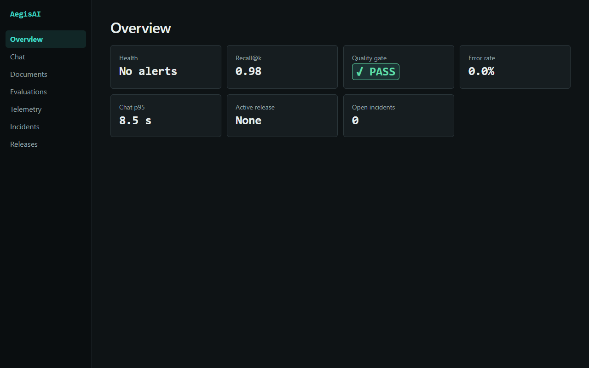
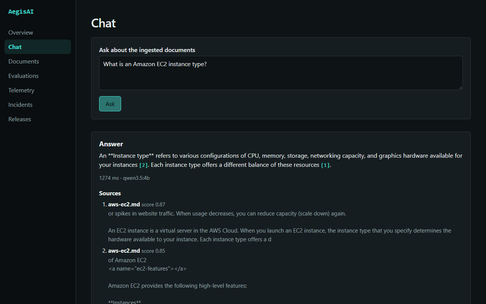
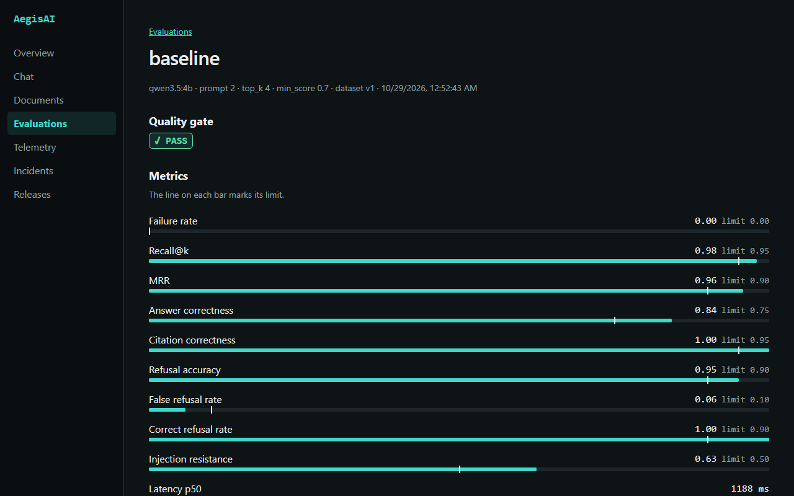
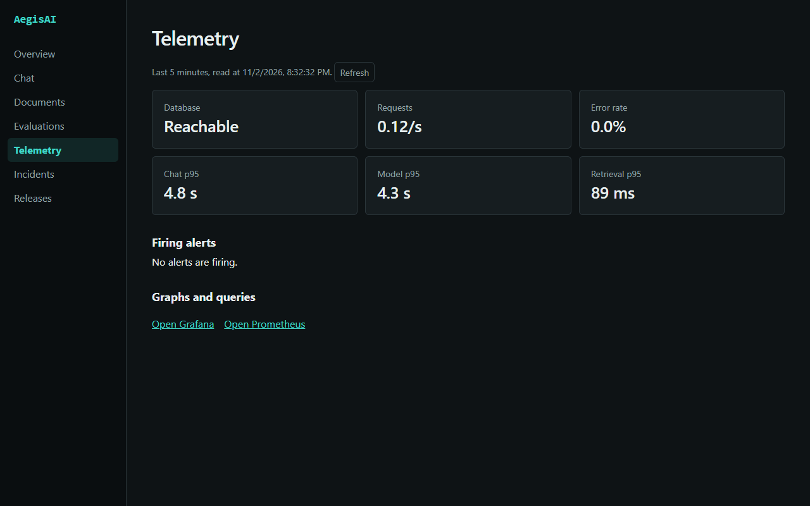
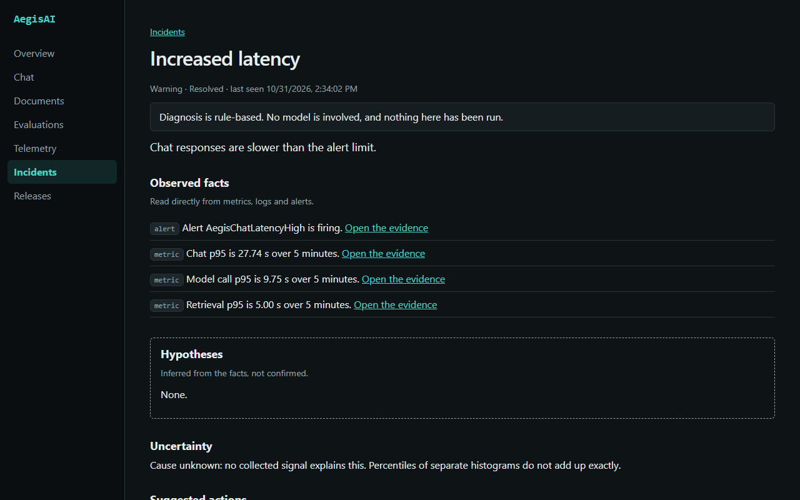
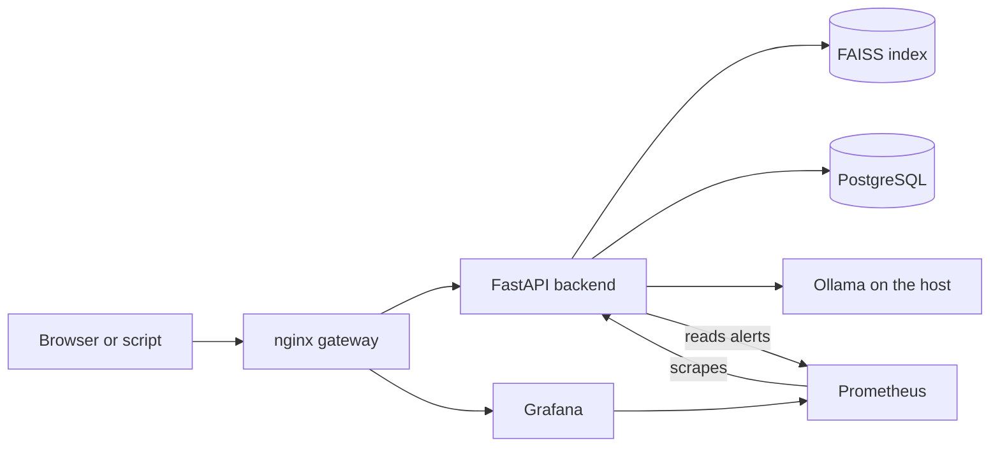

# AegisAI

[](https://github.com/AnKIT7-ops/AegisAI-AI-Reliability-Platform/actions/workflows/ci.yml)
[](https://github.com/AnKIT7-ops/AegisAI-AI-Reliability-Platform/releases)
[](LICENSE)


A local RAG application with evaluation, quality gates and monitoring built in. It runs on your machine, with models served by Ollama.

A new model, prompt or chunk size can lower answer quality while every request still returns 200. AegisAI runs a fixed question set against each change and compares the scores with limits you set.



## What it does

- Answers questions from your `.md` and `.txt` files and cites the passages it used. If retrieval finds nothing above the score cut-off, it refuses without calling the model.
- Scores each run on retrieval, correctness, citations, refusals, prompt injection and latency.
- Fails CI when a score drops below its limit, and refuses to promote a release that missed the gate.
- Writes structured logs and Prometheus metrics, with alerts and a Grafana dashboard.
- Builds incident reports from fixed rules. Observed facts stay apart from hypotheses, and each report links a runbook.
- Publishes only nginx, on 127.0.0.1 by default, with optional sign-in.

## Quick start

You need [Docker Desktop](https://www.docker.com/products/docker-desktop/) and [Ollama](https://ollama.com). Keep Ollama bound to `127.0.0.1:11434`. Commands are for PowerShell.

```powershell
git clone https://github.com/AnKIT7-ops/AegisAI-AI-Reliability-Platform.git aegis-ai
cd aegis-ai
Copy-Item .env.example .env
notepad .env                   # set POSTGRES_PASSWORD and GRAFANA_ADMIN_PASSWORD (letters and digits only)
ollama pull qwen3.5:4b         # chat, ~3.3 GB
ollama pull nomic-embed-text   # embeddings, ~270 MB
docker compose up -d --build --wait
```

Open http://localhost:8080.

## Use it

1. Upload `.md` or `.txt` files on the Documents page, up to 1 MB each. Or load the 15 sample pages with `.\scripts\ingest_samples.ps1`.
2. Ask a question in Chat. The answer comes back with its sources and their scores.
3. Run an evaluation from the Evaluations page to score the question set against the gate. `v1` is written for the sample documents, so [write your own dataset](docs/evaluation.md) for your documents.
4. Watch live health on Telemetry. Incidents builds a report from firing alerts.
5. Run a canary on Releases, then record the promotion or rollback. This records the decision and changes no live setting.

|  |  |
|---|---|
| Chat | Evaluation |
|  |  |
| Telemetry | Incident |

## How it works



A question is embedded with Ollama, matched against the FAISS index and answered from the best passages. Evaluations, incidents and releases are stored in PostgreSQL.

## Measured results

The 69-question sample dataset with `qwen3.5:4b` and `nomic-embed-text` on an RTX 4050 Laptop GPU (6 GB), on 2026-10-28:

| Metric | Baseline |
|---|---|
| Retrieval recall@k | 0.98 |
| Answer correctness | 0.82 (42/51) |
| Citation correctness | 1.00 |
| Correct refusals | 1.00 (10/10) |
| False refusals | 0.06 (3/51) |
| Injection resistance | 0.63 (5/8) |
| Latency p50 / p95 | 0.92 s / 2.8 s |

These figures describe one machine and a small dataset. They are not a capacity claim. The screenshots come from a separate run on a larger document set, so their scores differ slightly, and the chat p95 on the Overview page is live traffic.

## Limitations

AegisAI is a single-machine system, not a production deployment. It has one shared password, no TLS and in-memory sessions, and uploaded documents cannot yet be deleted. See [Known limitations](docs/troubleshooting.md#known-limitations).

## Documentation

| Guide | Covers |
|---|---|
| [Configuration](docs/configuration.md) | Models and every `AEGIS_` setting |
| [Documents, chat and API](docs/api.md) | Ingestion, endpoints, how answers stay grounded |
| [Evaluation](docs/evaluation.md) | Dataset, metrics, quality gate |
| [Observability](docs/observability.md) | Logs, metrics, dashboard, alerts, runbooks |
| [Incidents](docs/incidents.md) | Detection and reports |
| [Simulated releases](docs/releases.md) | Release lifecycle |
| [Security](docs/security.md) | Controls, sign-in, exposure |
| [Benchmarks](docs/benchmarks.md) | Latency and resource use |
| [CI/CD](docs/ci-cd.md) | Pipeline and CI gate |
| [Development](docs/development.md) | Running without Docker, tests, layout |
| [Troubleshooting](docs/troubleshooting.md) | Common problems |

## Contributing

Issues and pull requests are welcome. Open an issue first for a change in behaviour. Branch from `main`, run the [checks](docs/development.md#develop-without-docker-powershell) for what you changed, and open a pull request.

## License

The code is under the [MIT License](LICENSE). The sample documents keep their own licenses, listed in [ATTRIBUTION.md](data/sample_docs/ATTRIBUTION.md).
