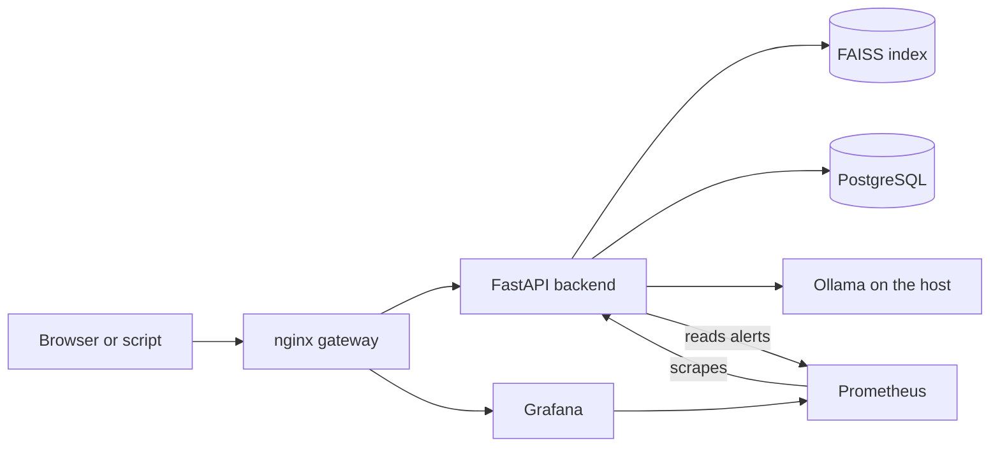

# AegisAI

[](https://github.com/AnKIT7-ops/AegisAI-AI-Reliability-Platform/actions/workflows/ci.yml)
[](https://github.com/AnKIT7-ops/AegisAI-AI-Reliability-Platform/releases)
[](LICENSE)


**Find out if your RAG application is getting worse before your users do.**

AegisAI answers questions from your own documents, scores those answers, blocks releases that fall below your limits and explains failures from evidence. It runs on your machine, with local models through Ollama.


## Why it matters

A RAG application can break quietly. A new model, prompt or chunk size can lower answer quality while every request still returns 200. AegisAI turns that risk into numbers you can check on every change.

## What it does

- **Answers with sources.** Every answer cites numbered passages. If nothing relevant is found, it refuses without calling the model.
- **Scores quality.** A versioned question set measures retrieval, correctness, citations, refusals, prompt injection and latency.
- **Blocks regressions.** Quality gates run in CI, and failing releases cannot be promoted.
- **Shows what is happening.** Structured logs, Prometheus metrics, alerts and a Grafana dashboard.
- **Diagnoses incidents.** Fixed rules keep observed facts apart from hypotheses, and each incident links a runbook.
- **Stays local.** Only nginx is published, on 127.0.0.1 by default, with optional sign-in.

## Quick start

You need [Docker Desktop](https://www.docker.com/products/docker-desktop/) and [Ollama](https://ollama.com). Keep Ollama bound to `127.0.0.1:11434`. Commands are for PowerShell.

```powershell
git clone https://github.com/AnKIT7-ops/AegisAI-AI-Reliability-Platform.git aegis-ai
cd aegis-ai
Copy-Item .env.example .env
notepad .env                   # set POSTGRES_PASSWORD and GRAFANA_ADMIN_PASSWORD (letters and digits only)
ollama pull qwen3.5:4b         # chat, ~3.3 GB
ollama pull nomic-embed-text   # embeddings, ~270 MB
docker compose up -d --build --wait
```

Open http://localhost:8080.

## Use it

1. **Add documents.** Upload `.md` or `.txt` files on the Documents page, up to 1 MB each. Or load the 15 sample pages with `.\scripts\ingest_samples.ps1`.
2. **Ask a question.** Chat returns an answer with its sources and scores.
3. **Run an evaluation.** The Evaluations page scores the question set and shows the quality gate. `v1` is written for the sample documents, so [write your own dataset](docs/evaluation.md) for your documents.
4. **Watch and diagnose.** Telemetry shows live health, and Incidents builds a report from firing alerts.
5. **Record a release.** Releases runs a canary against the gate, then records promotion or rollback. It records the decision and changes no live setting.

|  |  |
|---|---|
| Chat | Evaluation |
|  |  |
| Telemetry | Incident |

## How it works



A question is embedded with Ollama, matched against the FAISS index and answered from the best passages. Evaluations, incidents and releases are stored in PostgreSQL.

## Measured results

The 69-question sample dataset with `qwen3.5:4b` and `nomic-embed-text` on an RTX 4050 Laptop GPU (6 GB), on 2026-10-28:

| Metric | Baseline |
|---|---|
| Retrieval recall@k | 0.98 |
| Answer correctness | 0.82 (42/51) |
| Citation correctness | 1.00 |
| Correct refusals | 1.00 (10/10) |
| False refusals | 0.06 (3/51) |
| Injection resistance | 0.62 (5/8) |
| Latency p50 / p95 | 0.92 s / 2.8 s |

These figures describe one machine and a small dataset. They are not a capacity claim.

## Limitations

AegisAI is a single-machine system, not a production deployment. It has one shared password, no TLS and in-memory sessions, and uploaded documents cannot yet be deleted. See [Known limitations](docs/troubleshooting.md#known-limitations).

## Documentation

| Guide | Covers |
|---|---|
| [Configuration](docs/configuration.md) | Models and every `AEGIS_` setting |
| [Documents, chat and API](docs/api.md) | Ingestion, endpoints, how answers stay grounded |
| [Evaluation](docs/evaluation.md) | Dataset, metrics, quality gate |
| [Observability](docs/observability.md) | Logs, metrics, dashboard, alerts, runbooks |
| [Incidents](docs/incidents.md) | Detection and reports |
| [Simulated releases](docs/releases.md) | Release lifecycle |
| [Security](docs/security.md) | Controls, sign-in, exposure |
| [Benchmarks](docs/benchmarks.md) | Latency and resource use |
| [CI/CD](docs/ci-cd.md) | Pipeline and CI gate |
| [Development](docs/development.md) | Running without Docker, tests, layout |
| [Troubleshooting](docs/troubleshooting.md) | Common problems |

## Contributing

Issues and pull requests are welcome. Open an issue first for a change in behaviour. Branch from `main`, run the [checks](docs/development.md#develop-without-docker-powershell) for what you changed, and open a pull request.

## License

The code is under the [MIT License](LICENSE). The sample documents keep their own licenses, listed in [ATTRIBUTION.md](data/sample_docs/ATTRIBUTION.md).
